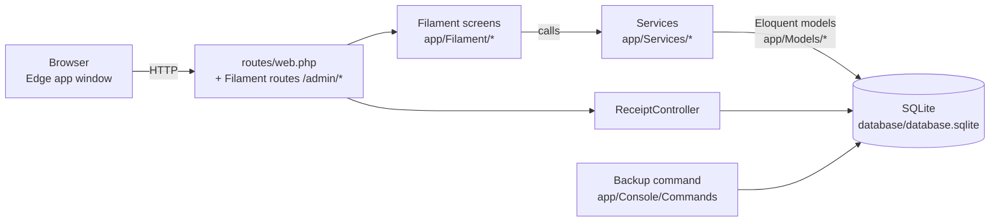
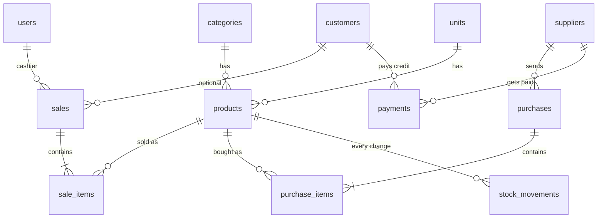

# Smart Mart POS: Developer Guide

This guide takes you from an empty computer to understanding every part of the app. Work through it in order:

1. [Set up the project on your computer](#1-set-up-on-your-computer)
2. [Use the app as the owner and as a cashier](#2-use-the-app-first)
3. [The big picture: how the pieces fit](#3-the-big-picture)
4. [The database: every table](#4-the-database)
5. [File-by-file tour](#5-file-by-file-tour)
6. [Follow the code: what happens when…](#6-follow-the-code-what-happens-when)
7. [Tests](#7-tests)
8. [How to make a change safely](#8-how-to-make-a-change-safely)
9. [Shipping to the shop PC](#9-shipping-to-the-shop-pc)
10. [Problems and fixes](#10-problems-and-fixes)
11. [Learning checklist](#11-learning-checklist)

---

## 1. Set up on your computer

### What you need

| Tool | Version | Why |
| --- | --- | --- |
| PHP | 8.3 or newer | Runs Laravel |
| Composer | 2.x | Installs PHP packages (`vendor/`) |
| Git | any | Gets the code from GitHub |
| A code editor | VS Code or PhpStorm | Reading and editing |
| A database viewer (optional) | DB Browser for SQLite or TablePlus | Looking inside `database.sqlite` |

Node.js is **not** needed. Filament ships its own ready-built CSS and JavaScript.

### Install PHP and Composer

**Windows (recommended for this project, because the shop runs Windows).** Open PowerShell **as Administrator** and run Laravel's official installer:

```powershell
Set-ExecutionPolicy Bypass -Scope Process -Force; [System.Net.ServicePointManager]::SecurityProtocol = [System.Net.ServicePointManager]::SecurityProtocol -bor 3072; iex ((New-Object System.Net.WebClient).DownloadString('https://php.new/install/windows/8.5'))
```

Close and reopen the terminal. Alternatives: [Laravel Herd](https://herd.laravel.com) or [Laragon](https://laragon.org), which bundle PHP and Composer.

**macOS / Linux:**

```bash
/bin/bash -c "$(curl -fsSL https://php.new/install/mac/8.5)"     # macOS
/bin/bash -c "$(curl -fsSL https://php.new/install/linux/8.5)"   # Linux
```

Then check:

```bash
php -v
composer -V
php -m
```

`php -m` must list **pdo_sqlite, sqlite3, mbstring, intl, fileinfo, zip, gd** and **openssl**. If one is missing, open the file shown by `php --ini` and remove the `;` in front of `extension=<name>`.

### Get the code and run it

```bash
git clone https://github.com/rida-1234/smartmart.git
cd smartmart
composer install
```

Copy the settings file and create an app key (on Windows PowerShell use `copy` instead of `cp`):

```bash
cp .env.example .env
php artisan key:generate
```

Create the empty database file (Windows PowerShell: `New-Item database\database.sqlite`):

```bash
touch database/database.sqlite
```

Create all tables and load practice data:

```bash
php artisan migrate --seed
php artisan db:seed --class=DemoSeeder
```

Run the tests, then start the app:

```bash
php artisan test
php artisan serve
```

Open http://127.0.0.1:8000 and log in.

| Login | Password | Role |
| --- | --- | --- |
| `admin@smartmart.local` | `admin123` | Owner (sees everything) |
| `cashier@smartmart.local` | `cashier123` | Cashier (demo data only) |

To start over with clean demo data at any time:

```bash
php artisan migrate:fresh --seed
php artisan db:seed --class=DemoSeeder
```

> **What do these commands do?** `composer install` downloads Laravel, Filament and the other libraries listed in `composer.json` into `vendor/`. `migrate` runs the files in `database/migrations/` to create tables. `--seed` runs `database/seeders/DatabaseSeeder.php` (admin user, units, categories, settings). `DemoSeeder` adds 12 practice products, 2 customers, 1 supplier and a cashier.

---

## 2. Use the app first

Before reading code, use the app for 15 minutes so the code makes sense later.

**As the owner (`admin@smartmart.local`):**

1. **POS / Billing.** Type `rice` and press Enter. Type `8900000000035` (Tea) and press Enter. Change a quantity. Press **F2**. A receipt prints (in the browser's print dialog).
2. **Bills.** Open the bill you just made. Click **Return item** and return 1 unit.
3. **Products.** Notice the red badge: products at or below their low-stock level. Open **Adjust stock** on one product and set a counted number.
4. **Purchases > New.** Pick "City Wholesale", add "Fresh Milk 1L", quantity 24, cost 40, paid 500. Save. Milk stock goes up, and the supplier now shows an amount owed.
5. **Suppliers.** Click **Pay** on City Wholesale.
6. **POS** again. Choose **Credit**, pick customer "Ahmed", and pay with an empty amount. Then go to **Customers** and use **Receive payment**.
7. **Reports.** Look at today's sales, profit and the day-closing box. Type a counted cash amount.
8. **Settings.** Change the shop name, click **Backup now**, then reprint a receipt to see the new name.

**As the cashier (`cashier@smartmart.local`):** log out and log in again. You only see POS, Bills (your own) and Customers. Try opening http://127.0.0.1:8000/admin/products: you get **403 Forbidden**.

Now open the database in DB Browser for SQLite (`database/database.sqlite`) and look at `sales`, `sale_items` and `stock_movements`. Every click above left a row there.

---

## 3. The big picture



**Three layers. Know which one you are in:**

| Layer | Folder | Job | Rule |
| --- | --- | --- | --- |
| Screens | `app/Filament`, `resources/views` | Show data, collect input | No money or stock maths here |
| Services | `app/Services` | All business rules: totals, stock, balances | Every change is inside `DB::transaction` |
| Models | `app/Models` | One class per table, relationships, casts | No business rules |

**Libraries used:**

- **Laravel 13**: the framework (routing, database, auth, commands).
- **Filament 5**: builds the admin panel: login, menus, tables, forms, actions. A "Resource" = a list/create/edit/view set of screens for one model.
- **Livewire 4**: lets a PHP class react to clicks and typing without writing JavaScript. Every Filament page is a Livewire component. The POS screen uses it directly.
- **Alpine.js** (comes with Livewire): small bits of in-browser behaviour, e.g. keyboard shortcuts on the POS.
- **SQLite**: the database is one file. No database server.

---

## 4. The database

All shop tables are created in one migration: `database/migrations/2026_11_16_000001_create_shop_tables.php`. Users are in `0001_01_01_000000_create_users_table.php` (with the added `role` and `is_active` columns).



| Table | What one row means | Notes |
| --- | --- | --- |
| `users` | A login | `role` = `admin` or `cashier`; `is_active=false` blocks login |
| `categories`, `units` | Grocery, Dairy… / pcs, kg… | Lookup lists |
| `products` | One item on the shelf | `stock` is the current quantity. `decimal(12,3)` so 0.5 kg works |
| `sales` | One bill | `invoice_no` like `INV-000001`; `due` = credit still owed on this bill; `status` = completed/returned |
| `sale_items` | One line on a bill | Copies `name`, `sale_price`, **`cost_price`** at the moment of sale; `returned_qty` grows on returns |
| `purchases` | One supplier bill | `due` = what was not paid |
| `purchase_items` | One line on a supplier bill | |
| `customers` | A customer | `balance` = credit they owe the shop |
| `suppliers` | A supplier | `balance` = what the shop owes them |
| `payments` | Money received from a customer or paid to a supplier | "Polymorphic": `payable_type` says Customer or Supplier, `payable_id` says which one |
| `expenses` | Rent, salary, bills… | |
| `stock_movements` | **Every** stock change: `purchase` (+), `sale` (−), `return` (+), `adjustment` (±) | `reference_type/id` points to the sale or purchase; `cash_refund` on returns |
| `settings` | Key/value pairs: shop name, currency, backup folder… | Read with `Setting::get('shop_name')` |

**Two ideas worth understanding:**

1. **Stock has an audit trail.** For any product, `SUM(stock_movements.qty)` equals `products.stock`. If those ever differ, something changed stock without going through a service. Check it yourself:

   ```bash
   php artisan tinker
   ```
   ```php
   $p = App\Models\Product::first();
   [$p->stock, $p->movements()->sum('qty')];   // the two numbers must match
   ```

2. **Bills remember the price and cost.** If tomorrow rice costs more, yesterday's profit must not change. That's why `sale_items` stores its own `cost_price`.

**Database settings** (`config/database.php`, the `sqlite` block): WAL mode lets reports read while a sale is being written; `busy_timeout` waits instead of failing when the file is busy; `IMMEDIATE` transactions avoid "database is locked" errors.

---

## 5. File-by-file tour

Files you will rarely touch (framework defaults) are left out: `config/*` except `database.php`, `public/*`, `storage/*`, `artisan`, `composer.lock`.

### Project root

| File | Purpose |
| --- | --- |
| `composer.json` | PHP packages: `laravel/framework`, `filament/filament`. After install it runs `filament:upgrade`, which copies Filament's CSS/JS into `public/` |
| `.env.example` | Template for `.env` (your local settings, never committed). Uses SQLite and file sessions |
| `phpunit.xml` | Test settings. Tests use an in-memory SQLite database, so they never touch your real data |
| `README.md` | Short overview and shop instructions |
| `CLAUDE.md` | The project's rules in five lines (also read by AI assistants) |
| `.github/workflows/tests.yml` | GitHub runs `php artisan test` on every push and pull request |

### `bootstrap/` and `routes/`

| File | Purpose |
| --- | --- |
| `bootstrap/app.php` | App setup. `redirectGuestsTo('/admin/login')` sends logged-out users to the login page |
| `bootstrap/providers.php` | Registers `AdminPanelProvider` (the Filament panel) |
| `routes/web.php` | `/` → redirects to `/admin/pos`; `/receipts/{sale}` → printable receipt (login required). All `/admin/*` routes come from Filament automatically |

### `app/Models/` (one class per table)

| File | Notes |
| --- | --- |
| `User.php` | Implements `FilamentUser`: `canAccessPanel()` lets only active users in. `isAdmin()` is used everywhere for permissions. `$attributes` gives new users the defaults `cashier` + active |
| `Product.php` | `scopeLowStock()` → `Product::lowStock()` = stock ≤ low_stock_level. `movements()` = its stock history |
| `Sale.php`, `SaleItem.php` | A bill and its lines |
| `Purchase.php`, `PurchaseItem.php` | A supplier bill and its lines |
| `Customer.php`, `Supplier.php` | Both have `payments()` (`morphMany`) |
| `Payment.php` | `payable()` (`morphTo`) returns the Customer or Supplier |
| `StockMovement.php` | One stock change; `reference()` returns the Sale or Purchase |
| `Expense.php`, `Category.php`, `Unit.php` | Simple |
| `Setting.php` | `Setting::get($key, $default)` and `Setting::put($key, $value)` |

Every model has `$fillable` (which columns may be mass-assigned) and `casts()` (e.g. `decimal:2` so money comes back as a fixed-point string, `date` for dates).

### `app/Services/` (the business rules: read these most carefully)

| File | Public methods | What it guarantees |
| --- | --- | --- |
| `CheckoutService.php` | `complete($lines, $paid, $method, $customerId, $billDiscount)` | Prices are read **from the database**, never from the screen. Saves sale + lines + stock movements + customer credit in **one transaction**. Short payment without a customer is refused. Invoice number = `INV-` + row id |
| | `returnItem($saleItem, $qty)` | Can't return more than was sold. Stock comes back. Refund = price actually paid (incl. discounts). Takes the refund off open credit first, returns the rest as cash (saved in `stock_movements.cash_refund`). Marks the bill `returned` when everything is back |
| `PurchaseService.php` | `record($data, $lines)` | Stock up, product `cost_price` updated to the latest buying price, unpaid part added to the supplier's balance |
| `LedgerService.php` | `receiveFromCustomer()`, `payToSupplier()` | Writes a `payments` row and lowers the balance |
| | `adjustStock($product, $newStock, $note)` | Sets stock to the counted number and logs the difference as an `adjustment` |
| `ReportService.php` | `summary($from, $to)` | Bills, net sales (after returns and bill discounts), cost of goods, gross and net profit, cash/card/credit split |
| | `expectedCash($day, $openingCash)` | What should be in the drawer: opening + cash sales + cash part of credit sales + credit received in cash − supplier cash payments − expenses − cash refunds |
| | `topProducts()`, `stockValue()`, `dues()` | Used by the Reports page |
| `ProductImportService.php` | `import($csvPath)` | Reads a CSV saved from Excel. Matches by barcode, then name. Creates missing categories/units. A `stock` column is applied through `adjustStock` (so it's logged) |

### `app/Filament/` (the screens)

**How a Filament Resource is organised** (example: Products):

```
Resources/Products/
  ProductResource.php      ← menu entry, permissions, which pages exist
  Schemas/ProductForm.php  ← the create/edit form fields
  Tables/ProductsTable.php ← list columns, filters, row buttons
  Pages/ListProducts.php   ← list page (+ header buttons: Import CSV, New)
  Pages/CreateProduct.php  ← create page (+ custom save logic)
  Pages/EditProduct.php    ← edit page
```

| File(s) | What's special |
| --- | --- |
| `Concerns/AdminOnly.php` | A trait with `canAccess()` → only admins. Added to every owner-only resource/page. Filament hides the menu item and returns 403 on the URL |
| `AvatarProviders/InitialsAvatarProvider.php` | Draws the user's initials locally (the default needs the internet) |
| `../Providers/Filament/AdminPanelProvider.php` | Panel setup: `/admin` path, login page, brand name, home = POS, menu groups (Sales, Inventory, Accounts, Settings), auto-discovery of resources/pages/widgets |
| `Pages/Pos.php` + `resources/views/filament/pages/pos.blade.php` | The billing screen. See [6.1](#61-a-cashier-scans-items-and-presses-f2) |
| `Pages/Reports.php` + `reports.blade.php` | Date range, summary tiles, top products, day closing, stock value and balances |
| `Pages/Settings.php` + `settings.blade.php` | A Filament form stored in the `settings` table, plus a **Backup now** button that runs the backup command |
| `Resources/Products/*` | Opening stock is saved as a logged adjustment (`CreateProduct::handleRecordCreation`). Stock can't be edited on the edit form, only through **Adjust stock**. **Import CSV** button. No delete (old bills point to products); deactivate instead |
| `Resources/Purchases/*` | Only List, Create and View pages: **no edit**. `CreatePurchase::handleRecordCreation` hands the form data to `PurchaseService` |
| `Resources/Sales/*` (menu name "Bills") | `canCreate/canEdit/canDelete` all return false. `getEloquentQuery()` shows cashiers only their own bills. `ViewSale` has **Reprint** and **Return item** (owner only) |
| `Resources/Customers/*`, `Suppliers/*` | **Receive payment** / **Pay** buttons call `LedgerService`. Opening balance can be set only when creating |
| `Resources/Expenses/*` | `CreateExpense` fills in `user_id` automatically. The list has a sum at the bottom |
| `Resources/Users/*` | Password is hashed by the model cast; empty password on edit = keep the old one. You can't deactivate yourself |
| `Resources/Categories/*`, `Units/*` | Plain lists, owner only |
| `Widgets/TodayStats.php`, `LowStockProducts.php` | Dashboard tiles and the reorder list (owner only) |

### Other app files

| File | Purpose |
| --- | --- |
| `app/Http/Controllers/ReceiptController.php` + `resources/views/receipts/show.blade.php` | The 80 mm receipt page. `?print=1` makes it call `window.print()` when loaded |
| `app/Console/Commands/BackupDatabase.php` | `php artisan smartmart:backup`: safe copy with SQLite `VACUUM INTO`, extra copy to the folder in Settings, deletes backups older than 30 days |
| `database/seeders/DatabaseSeeder.php` | What a fresh install starts with: admin, units, categories, settings. **Shipped to the shop** |
| `database/seeders/DemoSeeder.php` | Practice data. **Not** for the shop |

### `deploy/` (Windows packaging)

| File | Purpose |
| --- | --- |
| `build.ps1` | Builds `dist/bundle/`: copies the app, installs production packages, makes a production `.env` and a starter database, adds portable PHP |
| `php.ini` | Settings for the portable PHP (extensions, OPcache, timezone) |
| `start.bat` | Starts the hidden local server if it isn't running, then opens Edge in app mode with silent printing |
| `stop.bat` | Stops only this app's PHP processes |
| `backup.bat` | Runs the backup command; scheduled daily by the installer |
| `setup.iss` | Inno Setup script for the one-click installer. Never overwrites `database.sqlite` or `.env`, so updates keep shop data |

---

## 6. Follow the code: what happens when…

Open the files side by side while reading.

### 6.1 A cashier scans items and presses F2

```mermaid
sequenceDiagram
    participant U as Cashier (browser)
    participant P as Pos.php (Livewire)
    participant C as CheckoutService
    participant D as SQLite
    U->>P: types barcode + Enter (wire:keydown.enter="addByScan")
    P->>D: Product where barcode = ...
    P-->>U: re-renders the cart table
    U->>P: F2 (Alpine: $wire.pay())
    P->>C: complete(lines, paid, method, customerId, discount)
    C->>D: BEGIN; insert sale, sale_items, stock_movements; update stock / balance; COMMIT
    C-->>P: Sale
    P-->>U: notification + dispatch('pos-print', url)
    U->>U: hidden iframe loads /receipts/{id}?print=1 → print
```

Step by step in the code:

1. `pos.blade.php`: the scan box has `wire:model.live.debounce.250ms="scan"`, so typing updates `$scan` in `Pos.php` and the `results()` list (name search) re-renders. `wire:keydown.enter="addByScan"` calls the PHP method on Enter.
2. `Pos::addByScan()`: exact barcode first; otherwise, if the name search found exactly one product, add it.
3. `Pos::addProduct()`: puts `[name, price, qty, stock, unit]` into `$cart`, keyed by product id. The price here is **only for display**.
4. The `x-on:keydown.window.f2` attribute (Alpine) calls `$wire.pay()`.
5. `Pos::pay()`: an empty "amount received" means exact cash. It builds `[product_id, qty]` lines and calls `CheckoutService::complete()`.
6. `CheckoutService::complete()`: inside `DB::transaction`, reloads prices from the database, calculates totals, refuses a short payment without a customer, creates the `sales` row, sets `INV-000123`, creates `sale_items`, decrements stock, writes `stock_movements`, and raises the customer's balance for credit.
7. If the service throws a `ValidationException`, Livewire shows the message under the right field (`@error('paid')`).
8. On success `Pos` dispatches `pos-print`; Alpine creates a hidden `<iframe>` with the receipt URL; the receipt page prints itself.

**Hold bill** stores the cart in the PHP session (`session('pos.held')`), so held bills survive a page refresh but not a logout.

### 6.2 The owner records a supplier bill

`PurchaseForm` (fields and the items Repeater) → **Create** → `CreatePurchase::handleRecordCreation($data)` → `PurchaseService::record()` → for each line: `purchase_items` row, product `cost_price` updated, stock incremented, `stock_movements` (`purchase`). Unpaid part → `suppliers.balance`. Then the browser is sent to the View page.

### 6.3 An item is returned

`ViewSale` → **Return item** modal (pick the line, quantity) → `CheckoutService::returnItem()` → checks quantity, increases `returned_qty` and stock, works out the refund at the price actually paid, reduces open credit first, records `cash_refund` on a `return` movement → notification "Give back X in cash".

### 6.4 The Reports page calculates profit

`Reports.php` has `$from`/`$to` bound to the date inputs. Each `#[Computed]` method calls `ReportService`. In `summary()`:

- **Net sales** = Σ `sale_items.line_total` − returned share − bill discounts
- **Cost of goods** = Σ `cost_price × qty` − cost of returned units
- **Gross profit** = net sales − cost of goods; **Net profit** = gross profit − expenses

Profit is counted on the **day of the sale**. A return lowers the profit of the original sale's day, not the return day.

### 6.5 The nightly backup

Windows Task Scheduler (created by the installer) → `backup.bat` → `php artisan smartmart:backup` → `BackupDatabase::handle()` → `VACUUM INTO storage/backups/smartmart-YYYY-MM-DD_HHMMSS.sqlite` → extra copy to the Settings folder → prune files older than 30 days → save `last_backup_at`.

---

## 7. Tests

```bash
php artisan test                                   # everything
php artisan test --filter=ShopFlowTest             # one file
php artisan test --filter=test_return_restores     # one test
```

| File | What it proves |
| --- | --- |
| `tests/Feature/ShopFlowTest.php` | The services: cash sale, server-side prices, credit rules, returns, purchases, report numbers, stock adjustment |
| `tests/Feature/AdminScreensTest.php` | Every screen opens for the owner; cashier gets 403 on owner screens; POS scan→pay→print; hold/resume; product create logs opening stock; purchase form; return button; reports and settings; CSV import |
| `tests/Feature/BackupTest.php` | The backup command writes a file |

Tests use `RefreshDatabase`, so each test starts with empty tables in memory. Read a test first when you want to understand a feature: it shows the exact inputs and expected numbers.

---

## 8. How to make a change safely

**Example: add a "discount allowed" flag to products.**

1. **Migration** (never edit the old one; the shop's database already ran it):
   ```bash
   php artisan make:migration add_allow_discount_to_products_table
   ```
   ```php
   Schema::table('products', fn (Blueprint $t) => $t->boolean('allow_discount')->default(true));
   ```
2. **Model:** add `'allow_discount'` to `$fillable` and `'allow_discount' => 'boolean'` to `casts()` in `Product.php`.
3. **Form:** add `Toggle::make('allow_discount')` in `ProductForm.php`.
4. **Table:** add `IconColumn::make('allow_discount')->boolean()` in `ProductsTable.php`.
5. **Rule:** enforce it in `CheckoutService` (not in the screen).
6. **Test:** add a test in `ShopFlowTest.php`.
7. Run `php artisan migrate`, then `php artisan test`.
8. Commit on a branch, push, open a pull request. GitHub runs the tests.

**Rules that keep the numbers right:**

- Never write `$product->update(['stock' => ...])` or change a `balance` directly. Use a service.
- Never delete or edit sales or purchases. Correct mistakes with returns, adjustments and payments.
- Put every multi-table change inside `DB::transaction()`.
- Never edit a migration that has shipped to the shop.

**Useful commands:**

| Command | What it does |
| --- | --- |
| `php artisan tinker` | A PHP console with the app loaded, for trying queries |
| `php artisan route:list --path=admin` | Every screen URL |
| `php artisan migrate:fresh --seed` | Wipe and rebuild the local database |
| `php artisan make:filament-resource Name --generate` | Generate a new Resource from a model |
| `vendor/bin/pint` | Auto-format the code |
| `php artisan optimize:clear` | Clear cached config/routes/views when something looks stale |

---

## 9. Shipping to the shop PC

On a **Windows** machine with the project checked out:

1. Download PHP for Windows (8.3+, **x64 Non Thread Safe** zip) from https://windows.php.net/download/ and unzip it to `deploy\runtime\php\`.
2. Download `vc_redist.x64.exe` from https://aka.ms/vs/17/release/vc_redist.x64.exe into `deploy\runtime\`.
3. Run:
   ```powershell
   powershell -ExecutionPolicy Bypass -File deploy\build.ps1
   ```
4. Install [Inno Setup 6](https://jrsoftware.org/isinfo.php), open `deploy\setup.iss`, replace `PUT-YOUR-OWN-GUID-HERE` (Tools > Generate GUID, once, forever), set the backup time, and press **Compile**.
5. Test `dist\SmartMart-Setup-1.0.0.exe` on a spare Windows PC or a virtual machine before the shop.

On the shop PC the app lives in `C:\SmartMart`: `php\` (portable PHP), `app\` (Laravel), and the `.bat` files. The database is `C:\SmartMart\app\database\database.sqlite`, and backups are in `C:\SmartMart\app\storage\backups`.

**Updates:** bump `AppVersion` in `setup.iss`, rebuild, recompile, and run the new installer at the shop. It stops the app, backs up, replaces program files, keeps the database and `.env`, runs new migrations, and rebuilds the cache.

---

## 10. Problems and fixes

| Symptom | Cause | Fix |
| --- | --- | --- |
| `could not find driver` | `pdo_sqlite` not enabled | Enable `extension=pdo_sqlite` and `extension=sqlite3` in `php.ini` |
| `Database file at path [...] does not exist` | No database file yet | Create `database/database.sqlite`, then `php artisan migrate --seed` |
| `No application encryption key` | `.env` has no key | `php artisan key:generate` |
| Login page has no styling | Filament assets weren't copied into `public/` | `php artisan filament:upgrade` |
| `database is locked` | Another program (DB viewer) holds a write lock | Close the DB viewer's write transaction ("Write Changes" or "Revert") |
| Changes don't show up | Cached config/views | `php artisan optimize:clear` |
| Receipt prints with a dialog | Normal in a regular browser | `start.bat` opens Edge with `--kiosk-printing`; set the thermal printer as the Windows default |
| Cashier sees 403 | Working as designed | Only the owner can open those screens |

---

## 11. Learning checklist

Tick these off in order. Each one points you at code to read.

- [ ] Run the app and do every step in [section 2](#2-use-the-app-first)
- [ ] Open `database.sqlite` in a viewer and find your sale in `sales`, `sale_items` and `stock_movements`
- [ ] Read `CheckoutService::complete()` line by line; find where the price is read from the database
- [ ] In `php artisan tinker`, prove that a product's `stock` equals the sum of its movements
- [ ] Read `ShopFlowTest`; change an expected number and watch the test fail, then undo
- [ ] Read `Pos.php` and `pos.blade.php` together; find what F8 does in both files
- [ ] Find where cashiers are blocked from Products (hint: `AdminOnly`)
- [ ] Find why cashiers only see their own bills (hint: `getEloquentQuery`)
- [ ] Trace a purchase from `PurchaseForm` to `PurchaseService`
- [ ] Run `php artisan smartmart:backup` and open the file it made
- [ ] Make the practice change in [section 8](#8-how-to-make-a-change-safely) on a branch, with a test
